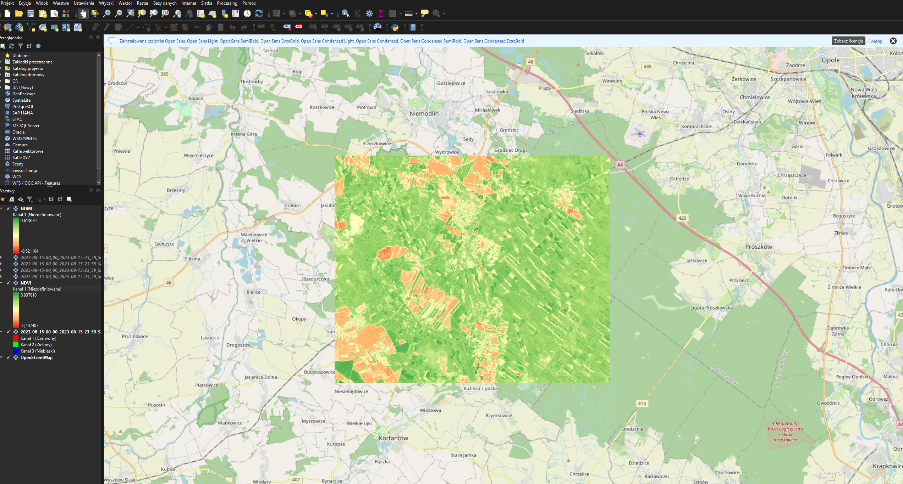
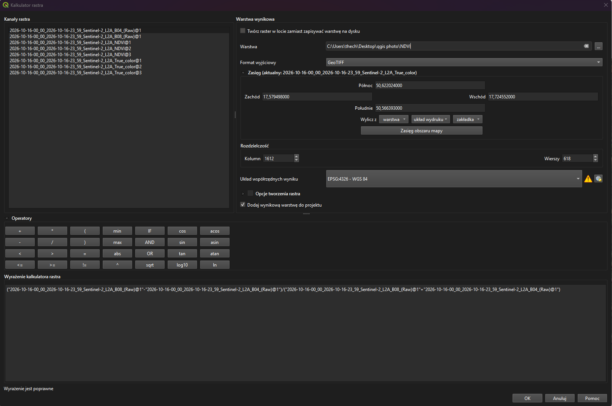
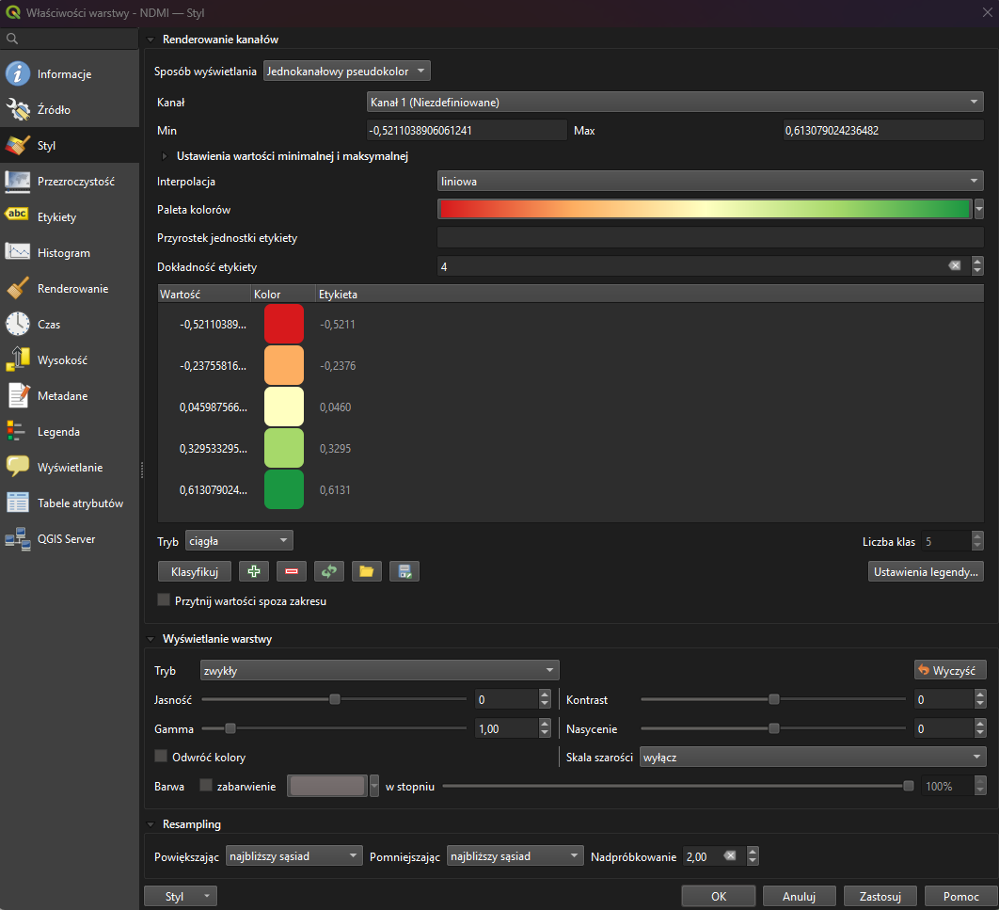
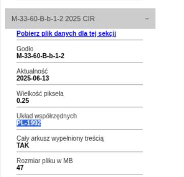
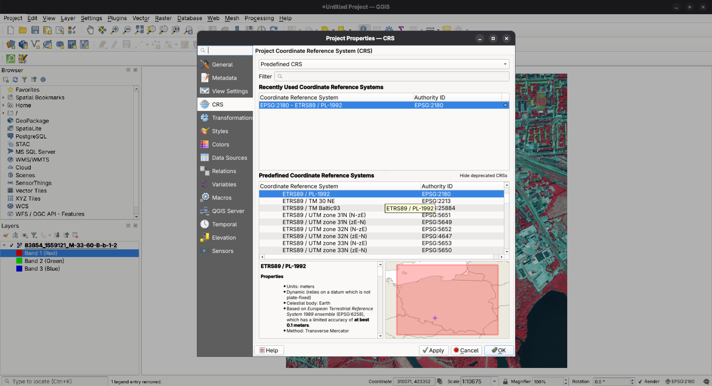
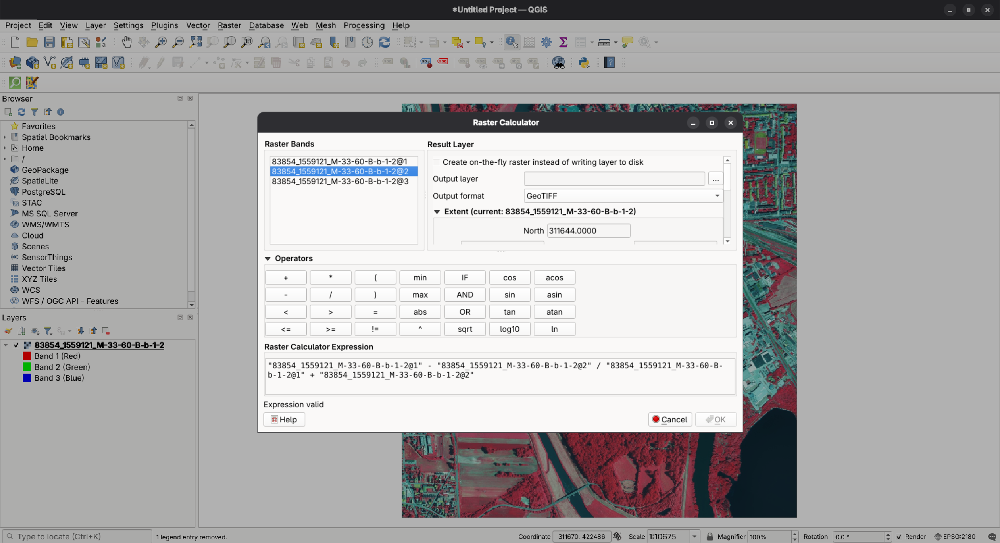
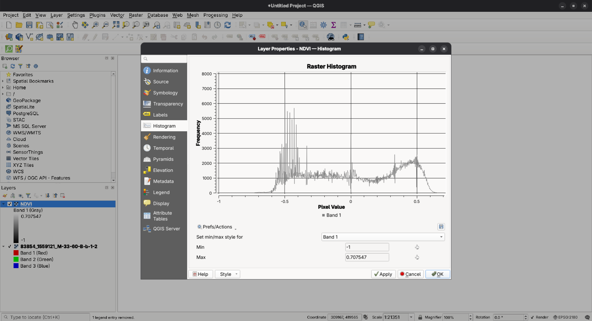
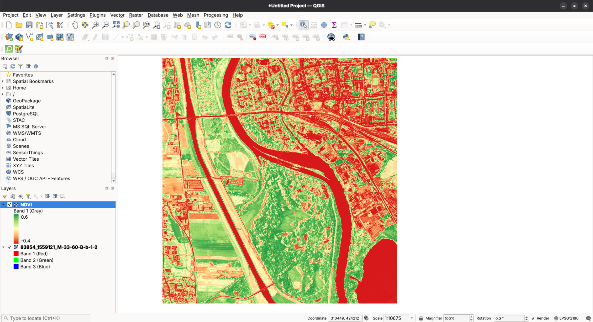

# Program Copernicus - obliczanie NDVI
# 1. Cel projektu

Celem projektu było obliczenie wskaźnika NDVI (*Normalized Difference Vegetation Index*) na podstawie zobrazowania satelitarnego Sentinel-2 oraz przedstawienie wyniku w programie QGIS. Dodatkowo porównano rastry `NDVI.tif` i `NDMI.tif`, aby określić zależność między wskaźnikiem roślinności a wskaźnikiem wilgotności.

NDVI wykorzystuje odbicie promieniowania w paśmie czerwonym (RED) oraz bliskiej podczerwieni (NIR). Zdrowa, aktywna roślinność pochłania znaczną część promieniowania czerwonego, a silnie odbija promieniowanie bliskiej podczerwieni.

Wskaźnik przyjmuje zwykle wartości od −1 do 1. Wyższe wartości na ogół wskazują na bardziej rozwiniętą lub aktywną roślinność. Wartości bliskie zeru mogą odpowiadać między innymi glebie odkrytej lub obszarom o niewielkim pokryciu roślinnością, natomiast wartości ujemne często występują nad wodą.

Wskaźnik oblicza się ze wzoru:

$$
NDVI = \frac{NIR - RED}{NIR + RED}
$$

W przypadku zobrazowań Sentinel-2 wykorzystywane są pasma B08 (bliska podczerwień, NIR) oraz B04 (pasmo czerwone, RED).

# 2. Pobranie danych ze strony Copernicus Browser

Dane satelitarne wykorzystane w analizie pobrano z serwisu Copernicus Browser, korzystając z zobrazowań satelitarnych Sentinel-2 L2A. Dla wybranego obszaru i daty 15.10.2026 r. pobrano pasma B04 (czerwone) i B08 (bliska podczerwień), niezbędne do obliczenia wskaźnika NDVI.

*Rysunek 2.1. Wybrany teren.*

Dodatkowo pobrano gotowe zobrazowanie NDVI oraz obraz w kompozycji True Color, który posłużył jako podkład do wizualizacji badanego terenu. Przy wyborze danych uwzględniono datę rejestracji oraz stopień zachmurzenia, aby zapewnić odpowiednią jakość zobrazowania. Pobrane pliki wykorzystano następnie w programie QGIS do analizy i prezentacji wyników.

*Rysunek 2.2. Wybrane pasma.*

# 3. Obliczanie NDVI w programie QGIS

## 3.1. Utworzenie projektu i wczytanie warstw

W programie QGIS utworzono nowy projekt i zapisano go w wybranym katalogu, aby zachować konfigurację oraz ścieżki do wykorzystywanych danych. Następnie wczytano rastry B04 i B08, odpowiadające odpowiednio pasmu czerwonemu oraz bliskiej podczerwieni.

Przed przystąpieniem do obliczeń sprawdzono, czy oba rastry obejmują ten sam obszar oraz czy ich rozdzielczość, zasięg i układ pikseli są zgodne.

*Rysunek 3.1. Wczytane rastry B04 i B08 w programie QGIS.*

## 3.2. Obliczenie wskaźnika w kalkulatorze rastrów

Wskaźnik NDVI obliczono w programie QGIS za pomocą Kalkulatora rastrów (*Raster Calculator*). Do wyrażenia matematycznego wykorzystano pasma B08, odpowiadające bliskiej podczerwieni, oraz B04, odpowiadające światłu czerwonemu. Wartość wskaźnika dla każdego piksela wyznaczono zgodnie ze wzorem:

$$
NDVI = \frac{B08 - B04}{B08 + B04}
$$

*Rysunek 3.2. Konfiguracja wyrażenia obliczającego wskaźnik NDVI w Kalkulatorze rastrów programu QGIS.*

Odwołania do rastrów dostosowano do nazw warstw widocznych w projekcie. Plik wynikowy zapisano w formacie GeoTIFF pod nazwą `NDVI.tif`. Przy konfiguracji obliczenia zachowano zasięg przestrzenny oraz rozdzielczość odpowiadające danym wejściowym. Po uruchomieniu kalkulatora otrzymano nową warstwę rastrową zawierającą wartości wskaźnika NDVI.

## 3.3. Ustawienie skali kolorów

W celu poprawy czytelności uzyskanego wyniku odpowiednio skonfigurowano wizualizację warstwy NDVI. Wybrany gradient barw, w którym niskie wartości wskaźnika reprezentowane są przez odcienie brązowe lub czerwone, wartości pośrednie przez kolor żółty, a wysokie wartości przez odcienie zieleni, ułatwia interpretację wyników i identyfikację obszarów o zróżnicowanej kondycji roślinności.

*Rysunek 3.3. Wizualizacja wskaźnika NDVI z zastosowaniem skali pseudokolorowej.*

Dobór kolorów jest sposobem prezentacji danych, a nie częścią obliczenia matematycznego. Legenda wskazuje, które kolory oznaczają niższe, a które wyższe wartości wskaźnika.

# 4. Interpretacja mapy NDVI

Wartości NDVI opisują różnicę między odbiciem promieniowania w bliskiej podczerwieni i paśmie czerwonym, odniesioną do sumy tych odbić. Wysokie dodatnie wartości zwykle odpowiadają obszarom z bujną, aktywną roślinnością. Niższe wartości mogą występować na terenach z rzadką roślinnością, odsłoniętą glebą, zabudową lub innymi powierzchniami nieporośniętymi roślinnością. Wartości ujemne często są związane z wodą lub innymi powierzchniami o odmiennej charakterystyce spektralnej.

NDVI nie jest bezpośrednim pomiarem biomasy ani jednoznaczną oceną zdrowia każdej rośliny. Wynik może zależeć między innymi od pory roku, wilgotności, rodzaju roślinności, zachmurzenia, cieni i właściwości gleby. Interpretację należy zatem odnosić do daty zobrazowania oraz charakterystyki badanego obszaru.

# 5. Porównanie plików NDVI i NDMI

## 5.1. Charakterystyka wskaźników

NDVI jest wskaźnikiem związanym z aktywnością i pokryciem roślinnością. Dla Sentinel-2 oblicza się go z pasm B08 i B04.

NDMI (*Normalized Difference Moisture Index*) jest wskaźnikiem wykorzystywanym do oceny wilgotności roślinności. Dla Sentinel-2 oblicza się go zwykle z pasma bliskiej podczerwieni B08 oraz pasma krótkofalowej podczerwieni SWIR, najczęściej B11:

$$
NDMI = \frac{NIR - SWIR}{NIR + SWIR}
$$

Wyższe wartości NDMI są zwykle interpretowane jako większa zawartość wilgoci w roślinności, a niższe jako mniejsza wilgotność lub bardziej suche warunki. Dokładna interpretacja zależy od rodzaju pokrycia terenu i warunków obserwacji.

## 5.2. Statystyki rastrów

Dla dostarczonych plików GeoTIFF zestawiono statystyki 2 710 608 wspólnych pikseli. Oba rastry mają rozmiar 2274 × 1192 piksele, układ współrzędnych EPSG:4326 i ten sam zasięg przestrzenny.

**Tabela 5.1. Statystyki wartości rastrów NDVI i NDMI**

| Statystyka | NDVI | NDMI |
|---|---:|---:|
| Liczba pikseli | 2 710 608 | 2 710 608 |
| Minimum | -0,4080 | -0,5901 |
| 1. percentyl | 0,1198 | -0,2290 |
| 25. percentyl | 0,7478 | 0,2026 |
| Mediana | 0,8125 | 0,3279 |
| Średnia | 0,7315 | 0,2540 |
| 75. percentyl | 0,8512 | 0,3709 |
| 99. percentyl | 0,9067 | 0,4789 |
| Maksimum | 0,9419 | 0,6572 |

Statystyki wskazują, że w rastrze NDVI większość pikseli ma stosunkowo wysokie wartości; mediana wynosi około 0,813. Może to oznaczać, że znaczna część analizowanego obszaru jest pokryta aktywną roślinnością. W rastrze NDMI mediana wynosi około 0,328, co wskazuje na przewagę dodatnich wartości wskaźnika wilgotności. Same statystyki nie pozwalają jednak ustalić rodzaju roślinności ani jednoznacznie ocenić jej stanu bez znajomości badanego terenu i daty zobrazowania.

## 5.3. Analiza korelacji NDVI i NDMI

Do oceny związku między wskaźnikami wykorzystano współczynnik korelacji liniowej Pearsona. Przyjmuje on wartości od −1 do 1:

- wartość bliska 1 oznacza silną dodatnią zależność liniową;
- wartość bliska −1 oznacza silną ujemną zależność liniową;
- wartość bliska 0 oznacza brak wyraźnej zależności liniowej.

Dla pikseli z plików `NDVI.tif` i `NDMI.tif` uzyskano współczynnik korelacji Pearsona:

$$
r = 0{,}9017
$$

Otrzymana wartość wskazuje na bardzo silną dodatnią korelację liniową. W analizowanych danych piksele o wyższych wartościach NDVI mają na ogół również wyższe wartości NDMI. Wynik jest zgodny z możliwością, że obszary z bardziej rozwiniętą roślinnością są często jednocześnie obszarami o większej zawartości wilgoci w roślinności.

Korelacja nie oznacza jednak, że wysoki NDVI powoduje wzrost NDMI. Oba wskaźniki są obliczane z pasm spektralnych i mogą reagować na wspólne czynniki, takie jak rodzaj pokrycia terenu, sezon, warunki atmosferyczne i właściwości roślinności. Silna korelacja dla całego obszaru nie musi występować w każdej jego części. Wynik należy interpretować jako zależność statystyczną między wartościami pikseli, a nie dowód związku przyczynowo-skutkowego.

---

# Mapy wysokorozdzielcze - CIR

## 1. Pobranie danych wysokorozdzielczych z Geoportal.gov.pl
Pobrano obszar CIR obejmujący wyspę Bolko.

## 2. Sprawdzenie czy jest dobry CRS

## 3. Obliczenie klastra dla NDVI
Na zrzucie ekranu brakuje () i nazwy warstwy, które dodano później. 

## 4. Histogram 
Sprawdzono histogram w celu dopasowania skali kolorów.

## 5. NDVI
Obliczone NDVI

Oryginalnego obrazka nie wrzucamy ze względu na rozmiar ~300mb, po konwersji do PNG ~100mb, bo dane wysokorozdzielcze, są naprawdę wysoko rozdzielcze ~9000x9000 px.

## Wnioski 

Za pomocą programu QGIS można w szybki sposób analizować interesujące nas wycinki danych satelitarnych. Program nie jest intuicyjny, ale po przyzwyczajeniu się nie jest taki zły.