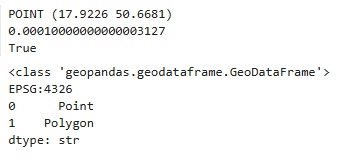
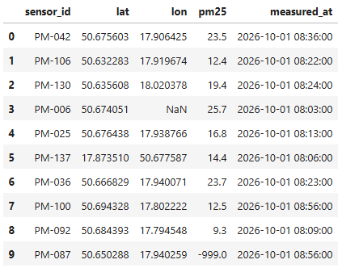
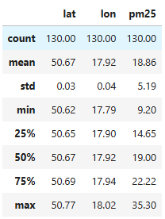
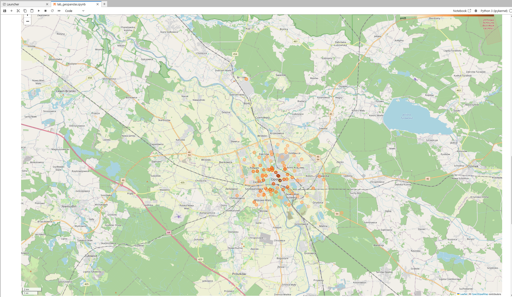

# Sprawozdanie – część A: GeoPandas

## 1. Cel ćwiczenia

Celem ćwiczenia było zapoznanie się z biblioteką GeoPandas oraz podstawowymi operacjami na danych przestrzennych. W ramach zadania utworzono geometrie, przeprowadzono analizę i czyszczenie danych pomiarowych oraz przygotowano wizualizację rozmieszczenia czujników PM2.5 na mapie.

## 2. A1 – Tworzenie geometrii przestrzennych

Za pomocą biblioteki Shapely utworzono dwa obiekty geometryczne: punkt reprezentujący Rynek w Opolu oraz poligon w kształcie kwadratu. Następnie obiekty umieszczono w strukturze GeoDataFrame z przypisanym układem współrzędnych EPSG:4326.

Sprawdzono typy utworzonych geometrii oraz układ odniesienia. Potwierdzono, że obiekty mają odpowiednio typ Point i Polygon.

*Rysunek 1. Wynik tworzenia geometrii punktowej i poligonowej.*

## 3. A2 – Wczytanie i analiza danych

Wczytano dane pomiarowe z pliku CSV zawierającego lokalizacje czujników oraz wartości stężenia pyłu PM2.5. Kolumnę z datą pomiaru zinterpretowano jako datę i czas.

Przeprowadzono analizę danych obejmującą statystyki opisowe, sprawdzenie brakujących wartości oraz identyfikację zduplikowanych rekordów. Wykryto nieprawidłowe wartości współrzędnych, braki danych oraz wartości PM2.5 oznaczone jako -999.

*Rysunek 2. Dane z pliku CSV.*

## 4. A3 – Czyszczenie danych

Przygotowano kopię danych przeznaczoną do dalszej analizy. Usunięto zduplikowane rekordy oraz wiersze, w których brakowało współrzędnych geograficznych.

Następnie wykryto rekordy, w których szerokość i długość geograficzna zostały zamienione miejscami. Nieprawidłowe współrzędne poprawiono, a rekordy z ujemnymi wartościami PM2.5 usunięto jako zawierające niepoprawne pomiary.

Po zakończeniu czyszczenia zbiór zawierał 130 rekordów. Uzyskane współrzędne wskazywały na obszar Opola i okolic.

*Rysunek 3. Przefiltrowane dane.*

## 5. A4 – Utworzenie GeoDataFrame i wizualizacja

Na podstawie oczyszczonych danych utworzono GeoDataFrame. Geometrię punktową wygenerowano na podstawie długości i szerokości geograficznej, przypisując układ współrzędnych EPSG:4326.

Sprawdzono typ geometrii, układ współrzędnych oraz graniczne wartości współrzędnych. Następnie przygotowano interaktywną mapę rozmieszczenia czujników, na której kolor punktów przedstawiał wartość stężenia PM2.5.

Dodatkowo sprawdzono wpływ zamiany kolejności współrzędnych podczas tworzenia geometrii. Wykazano, że nieprawidłowa kolejność długości i szerokości geograficznej powoduje umieszczenie punktów poza obszarem Opola.

*Rysunek 4. Mapa Opola.*

## 6. Wnioski

Python wraz z biblioteką GeoPandas jest w stanie łatwo i szybko przefiltrować dane i usunąć z nich nieprawidłowości. Biblioteka GeoPandas pozwoliła na przekształcenie danych pomiarowych z pliku CSV w obiekty geograficzne, które można analizować i przedstawiać na mapie.