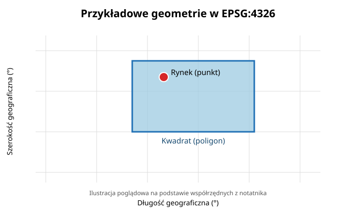
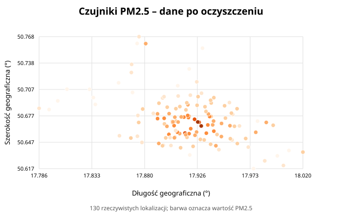
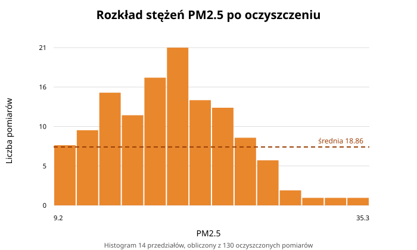

# Sprawozdanie 2 – analiza danych przestrzennych z GeoPandas

## 1. Cel ćwiczenia

Celem ćwiczenia było zapoznanie się z podstawowymi narzędziami biblioteki GeoPandas oraz przygotowanie danych tabelarycznych do analizy przestrzennej. Wykonano przykładowe geometrie, przeanalizowano i oczyszczono dane pomiarowe PM2.5, a następnie przedstawiono lokalizacje czujników na interaktywnej mapie.

## 2. Tworzenie geometrii

*Rysunek 1. Przykładowe geometrie utworzone w notatniku (schemat poglądowy).* 

Za pomocą biblioteki Shapely utworzono punkt odpowiadający Rynkowi w Opolu o współrzędnych (17.9226, 50.6681) oraz poligon kwadratowy. Sprawdzono geometrię punktu względem poligonu — punkt znajduje się wewnątrz kwadratu. Obiekty umieszczono w GeoDataFrame z układem współrzędnych EPSG:4326 (WGS 84). Sprawdzono typy geometrii oraz układ odniesienia.

Pole kwadratu wynosi około 0,0001 stopnia kwadratowego. Jest to jednostka wynikająca z geograficznego układu współrzędnych, a nie pole wyrażone w metrach kwadratowych.

## 3. Wczytanie i wstępna analiza danych

Z pliku `dane/pm25_sensors.csv` wczytano 145 rekordów zawierających identyfikator czujnika, szerokość i długość geograficzną, stężenie PM2.5 oraz czas pomiaru. Kolumnę `measured_at` odczytano jako datę i czas.

Obliczono statystyki opisowe dla współrzędnych i pomiarów, sprawdzono braki danych oraz duplikaty. W zbiorze wykryto 5 zduplikowanych rekordów, brakujące współrzędne oraz nieprawidłowe wartości `-999`, będące kodem błędu czujnika, a nie rzeczywistym pomiarem.

## 4. Czyszczenie danych

Dane oczyszczono w następującej kolejności:

1. usunięto duplikaty — pozostało 140 rekordów;
2. usunięto wiersze bez szerokości lub długości geograficznej — pozostały 134 rekordy;
3. wykryto 3 rekordy z zamienionymi miejscami współrzędnymi i poprawiono ich kolejność;
4. odrzucono pomiary PM2.5 mniejsze od zera, w tym wartość `-999` — końcowy zbiór zawiera 130 rekordów.

Po czyszczeniu współrzędne obejmowały obszar Opola i okolic. Wartości PM2.5 wynosiły od 9,2 do 35,3, a ich średnia wyniosła 18,86.

## 5. Utworzenie GeoDataFrame i mapa czujników

*Rysunek 2. Lokalizacje 130 czujników po oczyszczeniu danych; kolor odpowiada wartości pomiaru PM2.5.*

*Rysunek 3. Rozkład oczyszczonych pomiarów PM2.5 (14 przedziałów) i średnia.*

Na podstawie oczyszczonych danych utworzono GeoDataFrame. Geometrię punktową wygenerowano funkcją `points_from_xy`, podając długość geograficzną jako współrzędną X, a szerokość geograficzną jako Y. Warstwie przypisano układ EPSG:4326. Sprawdzono, że wszystkie geometrie są punktami; zasięg danych wynosił od 17,785622 do 18,020378° długości geograficznej oraz od 50,616593 do 50,767895° szerokości geograficznej.

Następnie utworzono interaktywną mapę za pomocą metody `explore`. Położenia czujników przedstawiono punktami, a kolor w skali pomarańczowej odpowiadał wartości stężenia PM2.5.

## 6. Wnioski

GeoPandas umożliwia połączenie danych tabelarycznych z geometrią i układem współrzędnych, co pozwala wykorzystywać je w analizie i wizualizacji przestrzennej. Przed utworzeniem mapy ważne jest sprawdzenie jakości danych: duplikatów, braków, wartości kodujących błędy oraz prawidłowej kolejności współrzędnych. W szczególności przy tworzeniu punktów długość geograficzna powinna być przekazana jako X, a szerokość geograficzna jako Y. Po oczyszczeniu danych można poprawnie przedstawić rozmieszczenie czujników i zakodować pomiary za pomocą koloru.

## 7. Środowisko

W notatniku wykorzystano biblioteki GeoPandas 1.2.0, Rasterio 1.5.2 (GDAL 3.12.2) oraz Shapely 2.2.0.
